# Credit card disputes on Orkes Conductor

A working demo of a card issuer's dispute process, built on [Orkes Conductor](https://orkes.io).

> **One call, one case per charge, the parent closes last.**
> A cardholder disputes several charges at once. Each charge becomes its own case with its own ID, deadline,
> merchant investigation and lifecycle. The parent dispute tracks all of them and closes only after the last one.

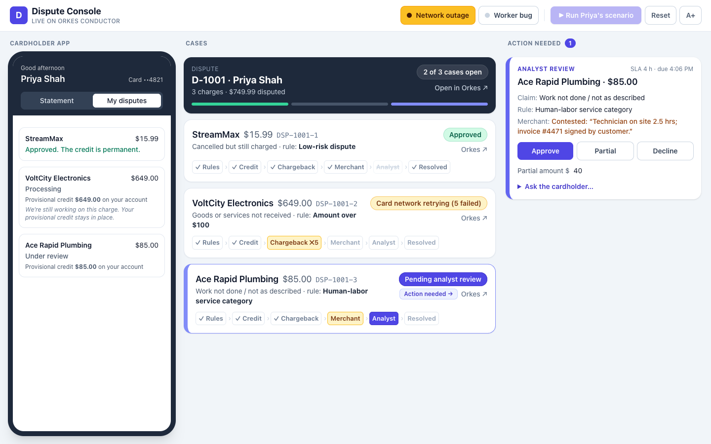

What you can show with it:

| Capability | Where you see it |
|---|---|
| Fan-out: one case per charge, parent closes last | Parent workflow with a dynamic fork of child workflows |
| Business rules as configuration | A decision table saved in Orkes, used by a `BUSINESS_RULE` task |
| Human in the loop | Analyst review form, a question-and-answer loop with the cardholder, SLA escalation |
| Long waits without using resources | Merchant response deadline and cardholder answers as `WAIT` tasks |
| Durability | Automatic retries, an ops exception queue, and "retry from the failed step" |
| Search and observability | Orkes execution search, diagrams, timelines, task logs |

**Contents**
1. [How it works](#1-how-it-works)
2. [Prerequisites](#2-prerequisites)
3. [Start the demo](#3-start-the-demo)
4. [The console](#4-the-console)
5. [Demo script](#5-demo-script)
6. [Stop, reset, troubleshoot](#6-stop-reset-troubleshoot)
7. [Automated end-to-end test](#7-automated-end-to-end-test)
8. [Project layout](#8-project-layout)
9. [Design notes](#9-design-notes)

---

## 1. How it works

### The pieces

Everything except Orkes runs on your machine: one container, or one script.

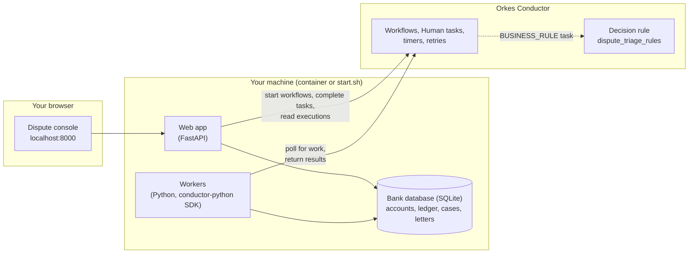

- **Orkes** runs the process. It decides what happens next, holds every wait (merchant deadline, analyst, cardholder), retries failures and evaluates the triage rules.
- **Workers** do the actual work against the "bank": open a case, post a credit, file a chargeback, send a letter. Each worker is one box in the workflow diagram.
- **The web app** serves the console. It starts workflows, completes Human and `WAIT` tasks, and reads the live execution from Orkes to show where each case is. There is no status-syncing code: Orkes is the source of truth for where a case is, and the bank database is the source of truth for money.

### Parent workflow: `dispute_intake` (one per dispute)

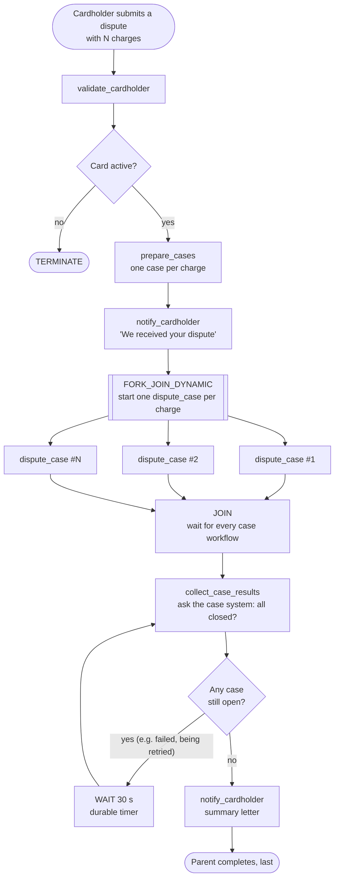

The dispute ID (e.g. `D-1001`) is the workflow's **correlation ID**, so you can search for it in Orkes.

### Child workflow: `dispute_case` (one per charge)

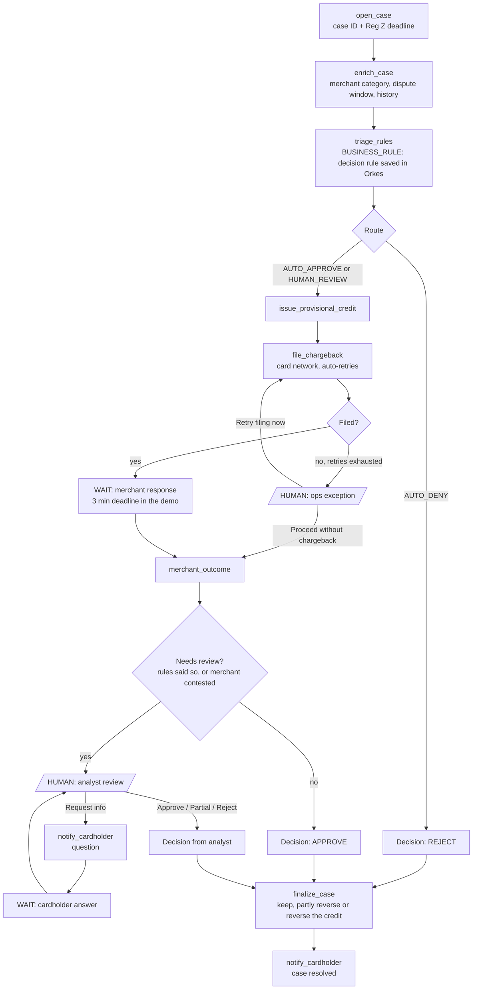

### Triage rules

Triage is a **decision rule saved in Orkes**, named `dispute_triage_rules` (**Definitions → Decision Rules**).
The `triage_rules` task references it by name, and the **first matching row wins**.
`rules/dispute_rules.csv` is its starting content: the demo saves it to Orkes every time it starts, so each demo starts from the same rules.

| outsideWindow | amount | category | priorDisputes90d | route | reason |
|---|---|---|---|---|---|
| true | Any | Any | Any | AUTO_DENY | Outside the 60-day dispute window |
| Any | >100 | Any | Any | HUMAN_REVIEW | Amount over $100 |
| Any | Any | contractor, home, personal or professional services, repair | Any | HUMAN_REVIEW | Human-labor service category |
| Any | Any | Any | >3 | HUMAN_REVIEW | Repeat disputer |
| Any | Any | Any | Any | AUTO_APPROVE | Low-risk dispute |

An edit saved in the Orkes rule editor applies to the next case. There's no deploy and no cache delay.

### When things go wrong: a case never silently dies

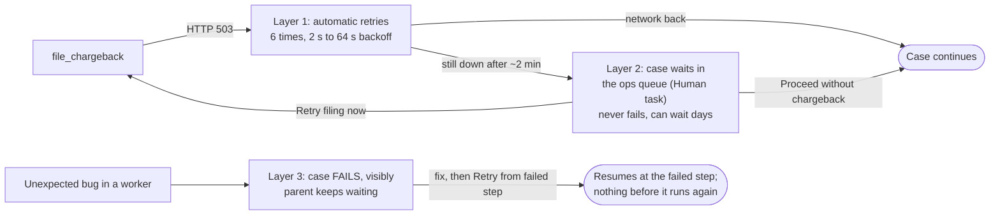

### The question-and-answer loop

The analyst's question and the cardholder's answer both run through the workflow, so each side's wait is a durable task.

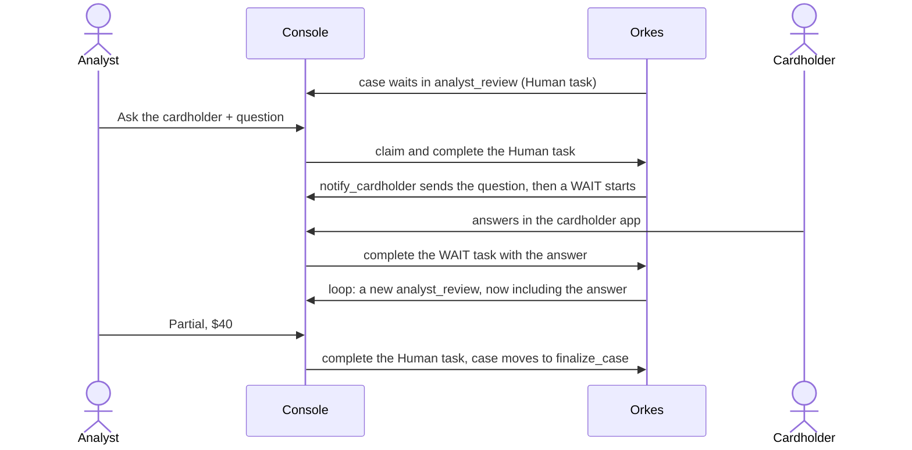

---

## 2. Prerequisites

| You need | Notes |
|---|---|
| An **Orkes Conductor** cluster, **v5.6 or later** | Orkes Cloud or Enterprise, with **Human Tasks** enabled. Tested on v5.6.2. Saved decision rules need v5.6. Open-source Conductor doesn't have the `HUMAN` and `BUSINESS_RULE` tasks. |
| An **application access key** | In the Orkes UI: **Access Control → Applications → Create application**. Give it the **Worker**, **Metadata API** and **Business Rule Manager** roles (tested with those plus **Application Creator**). Then **Create access key** and copy the key ID and secret. Everything the demo registers is owned by this application. |
| **Docker or Podman**, *or* **Python 3.10+** | The container needs nothing else installed. Without a container, `start.sh` needs Python (check with `python3 --version`) and a macOS or Linux shell (on Windows, use WSL). [uv](https://docs.astral.sh/uv/) is optional; `start.sh` uses it if present because it's faster. |
| Internet access | The console loads Tailwind and Alpine.js from public CDNs. |
| Port 8000 free | Or choose another (see below). |

---

## 3. Start the demo

### Step 1: credentials

```bash
git clone https://github.com/mangatrai/conductor-demos.git
cd conductor-demos
cp .env.example .env          # then edit .env
```

Fill in `.env` (at the repository root). It is git-ignored and is never copied into the container image.

```bash
CONDUCTOR_SERVER_URL=https://<your-cluster>.orkesconductor.io/api   # must end with /api
CONDUCTOR_AUTH_KEY=<key id>
CONDUCTOR_AUTH_SECRET=<key secret>
```

### Step 2, option A: run it in a container (recommended)

Nothing to install except Docker or Podman. The image holds the app, the workers and the bank database.

```bash
cd dispute_demo
docker build -t dispute-demo .
docker run --rm -it -p 8000:8000 --env-file ../.env dispute-demo
```

With Podman, use the same commands with `podman` in place of `docker`.

The container reads its settings from environment variables, passed with `--env-file` or `-e`
(the [Dockerfile](Dockerfile) lists them too):

| Variable | | |
|---|---|---|
| `CONDUCTOR_SERVER_URL` | required | Orkes API URL, ending in `/api` |
| `CONDUCTOR_AUTH_KEY` | required | Application access key ID |
| `CONDUCTOR_AUTH_SECRET` | required | Application access key secret |
| `KEEP_DATA` | optional | `1` skips the reset at startup and keeps earlier executions. Default `0` |
| `MERCHANT_AUTO_REPLY_SECONDS` | optional | How long auto-reply merchants wait before answering. Default `20` |

- **Another port:** change the host side of `-p`, for example `-p 9000:8000`, then open `http://localhost:9000/`. The startup message still says 8000, the port inside the container.
- **Stop:** press **Ctrl+C**, or run `docker stop <container>` from another terminal. `--rm` removes the container, and the next run starts with fresh bank data.
- **Run in the background:** replace `-it` with `-d --name dispute-demo`, follow with `docker logs -f dispute-demo` and stop with `docker stop dispute-demo`.
- **After changing the code:** run `docker build` again.

### Step 2, option B: run it with Python

```bash
./dispute_demo/start.sh
```

`start.sh` picks a Python: `$PYTHON` if set, else your active virtualenv, else it creates `.venv` at the repository root.
It installs `dispute_demo/requirements.txt`, then runs the startup steps below. Use `PORT=9000 ./dispute_demo/start.sh` for another port
and `./dispute_demo/start.sh --keep` to skip the reset. **Ctrl+C** stops everything.

### What happens at startup

The container and `start.sh` run the same steps:

1. Check `.env`, connect to Orkes, and check the version and roles. If something is wrong, it stops here and says what to fix.
2. Save the triage decision rule, then register the task definitions, the two user forms and the two workflows. Re-running this is safe.
3. Reset the demo: terminate and delete earlier `dispute_*` executions and reseed the bank data (skipped with `KEEP_DATA=1` or `--keep`).
4. Start the web app and the workers, and stay in the foreground.

When it's ready you'll see:

```
==> Starting web app + workers (Ctrl+C to stop)

  Dispute console   http://localhost:8000/

Dispute workers polling. Ctrl+C to stop.
```

**Before you present**, open two browser tabs: the console and the Orkes UI (**Executions → Workflow**).
Share the console tab, and switch to Orkes when the script says so.

---

## 4. The console

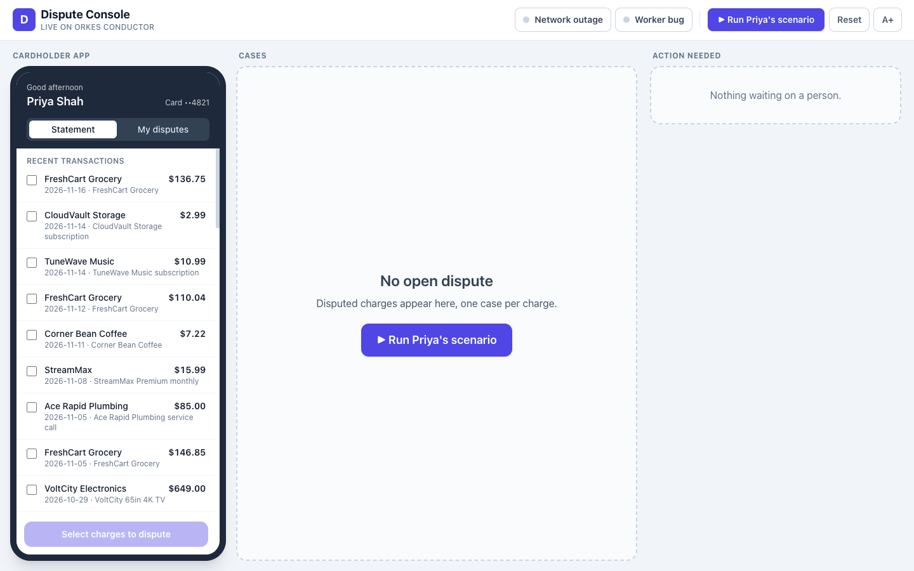

One screen shows the whole process: what the cardholder sees, every case, and every task waiting on a person.

- **Cardholder app (left).** Priya Shah's banking app. **Statement** lists her charges; tick some, pick a reason for each and dispute them. **My disputes** shows each charge's status in customer terms, any question from the bank with an answer box, and the final letter. Internal trouble (retries, ops, failures) shows here only as "Processing".
- **Cases (middle).** The dark card is the parent dispute: how many cases are still open, one progress bar per case, and, once closed, when it opened, when its last case closed and when the dispute closed. Below it is one card per charge, with the triage rule that routed it and six steps: Rules, Credit, Chargeback, Merchant, Analyst, Resolved. Click a case for its full history, built from the Orkes execution (internal events are tagged). **Orkes ↗** opens that execution.
- **Action needed (right).** Every task waiting on a person, each one an Orkes task:

  | Card | Orkes task | Buttons |
  |---|---|---|
  | Analyst review | `analyst_review` Human task, group `dispute-analysts`, 4-hour SLA | Approve, Partial (amount), Decline, Ask the cardholder |
  | Merchant (simulated) | `await_merchant_response` `WAIT` task | Contest, Accept. These merchants also reply by themselves after about 20 seconds. |
  | Ops exception | `chargeback_exception` Human task, group `dispute-ops`, 30-minute SLA | Retry filing now, Proceed without |
  | Failed step | The case workflow is `FAILED` | Retry from failed step |
  | Waiting on Priya | `await_cardholder_info` `WAIT` task | None; she answers in the cardholder app |

- **Top bar (demo controls).**
  - **Network outage:** the card network rejects VoltCity's chargebacks with HTTP 503. Other merchants are unaffected.
  - **Worker bug:** the final ledger step (`finalize_case`) fails with a non-retryable error, like a bad deploy.
  - **Run Priya's scenario:** disputes StreamMax $15.99, VoltCity Electronics $649.00 and Ace Rapid Plumbing $85.00 in one go.
  - **Reset:** terminates running disputes and reseeds the bank data.
  - **A+:** larger text for screen sharing.

Colours have one meaning each: **indigo** means a person must act, **amber** means waiting or retrying,
**green** means done or money back to the cardholder, and **red** means something broke.

---

## 5. Demo script

About 10 minutes, in five acts, then Orkes. Each act lists what to click, what happens, what to say, and what to show in Orkes.
Two things happen on their own while you talk: merchants reply about 20 seconds after a chargeback is filed,
and VoltCity's retries run out about 2 minutes after the dispute starts.

### Act 1: One call, one case per charge

**Click:** **Network outage** on, then **Run Priya's scenario**.

**What happens:** dispute `D-1001` appears with three cases, `DSP-1001-1` to `-3`. Each gets a provisional credit.
StreamMax and Ace file their chargebacks and wait for the merchant; VoltCity's filing fails and starts retrying.

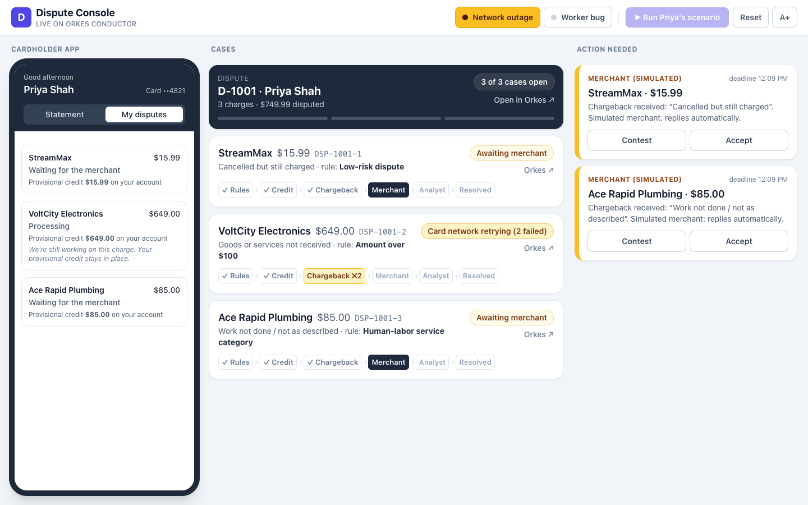

**Say:** Priya called about three charges. That one call is one dispute, and each charge is its own case with its own ID,
deadline and lifecycle. The cases run independently; the dispute waits for all of them.
Priya already has her money back as provisional credit.

**Show in Orkes:** open the parent (**Open in Orkes ↗** on the dark card), click **Expand** on `case_per_charge`.
The dynamic fork started one `dispute_case` workflow per charge, side by side.

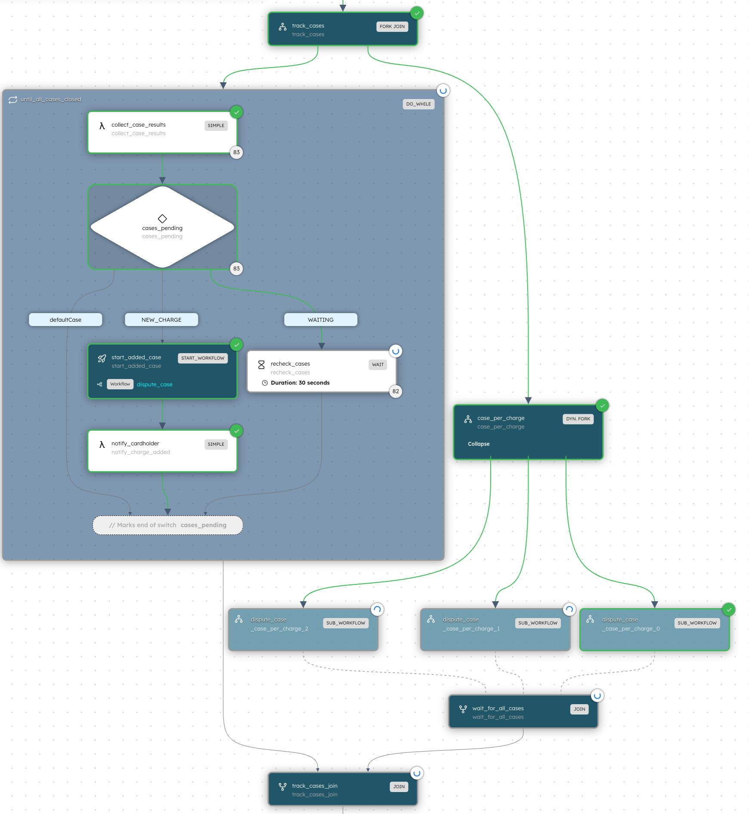

### Act 2: Rules decide

**What happens:** each case card shows the rule that routed it: StreamMax *Low-risk dispute* (auto-approve),
VoltCity *Amount over $100* and Ace *Human-labor service category* (both to an analyst).

**Say:** routing is a decision table, not code. A business user maintains it in Orkes, and a change applies to the next case.

**Show in Orkes:** **Definitions → Decision Rules → `dispute_triage_rules`**. In a case execution, the `triage_rules`
task's input has the facts (amount, category, window, history) and its output has `route` and `reason`.

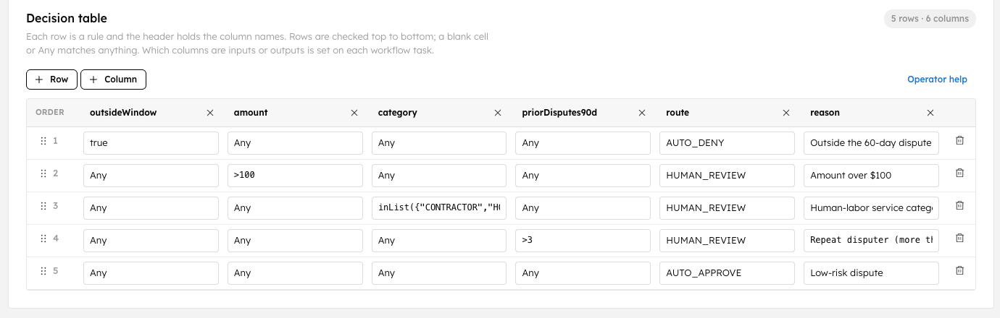

### Act 3: People in the loop

**What happens:** about 25 seconds in, StreamMax's merchant accepts and the case closes: the first one done, while the
dispute stays open. Ace's merchant contests, so Ace lands in **Action needed** as an **Analyst review**.


**Click:**
1. On Ace's analyst card, open **Ask the cardholder…** and click **Send question to Priya**.
   The case now waits on Priya; her app shows the question with an answer box.
2. In the cardholder app, click **Send answer**. Ace comes back to the analyst as round 2, with the conversation attached.
3. Click **Partial** ($40 is prefilled). Ace closes as *Partially approved*.

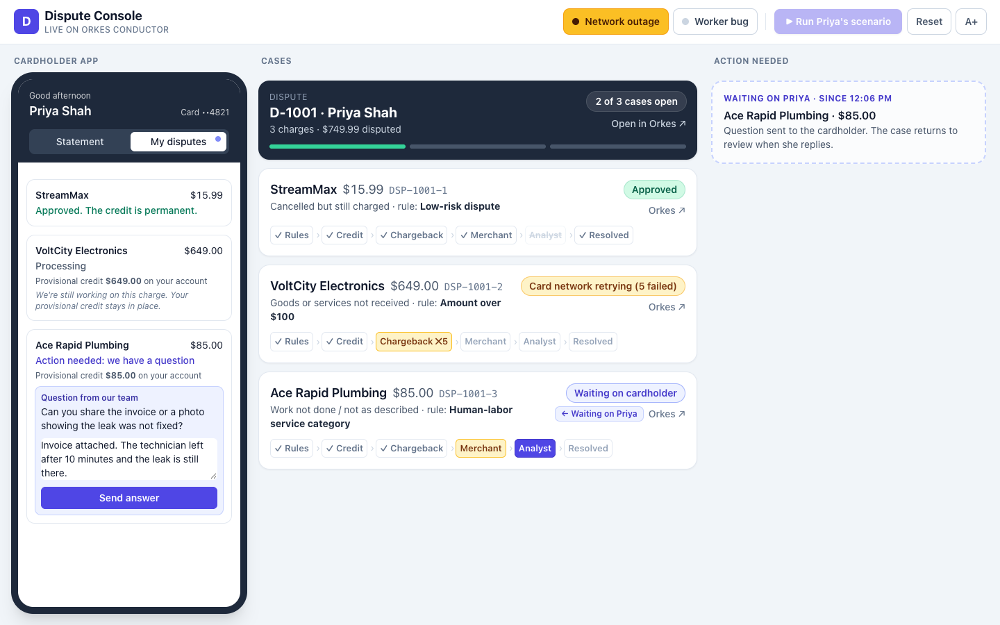

**Say:** each card on the right is an Orkes task with a form, an assignee group and an SLA, escalating to supervisors if
it's missed. When the analyst asks Priya a question, the workflow itself waits for her, for days if needed, with no
polling in our code. This console is the bank's own UI; the same tasks are in the Orkes Human Tasks inbox.

**Show in Orkes:** **Executions → Human Tasks**, and **Definitions → User Forms → `dispute_review_form`**: the analyst's
form, built in a drag-and-drop editor.

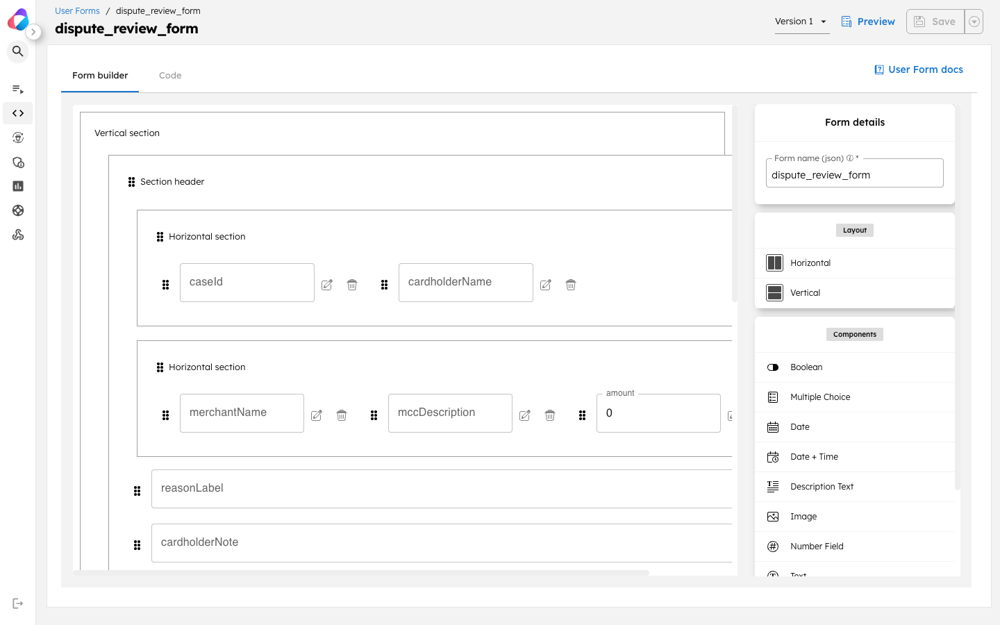

### Act 4: It never silently dies

**What happens:** VoltCity has been retrying with growing gaps. About 2 minutes in, the retries run out and the case
moves to **Ops exception**. It isn't failed: it's on hold with an owner and an SLA. Priya still just sees *Processing*.

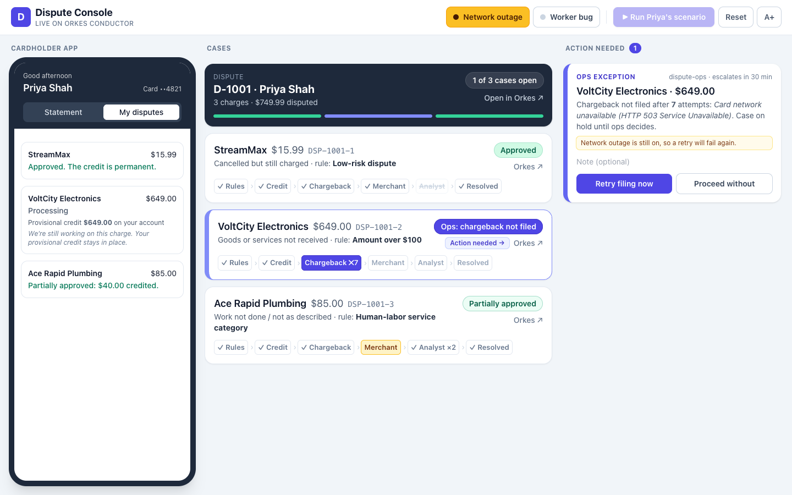

**Click:**
1. **Network outage** off, then **Retry filing now**. The chargeback files, the merchant contests, and VoltCity goes to an analyst.
2. **Worker bug** on, then **Approve** VoltCity. The last step fails and the case turns red: *Failed at finalize_case*.

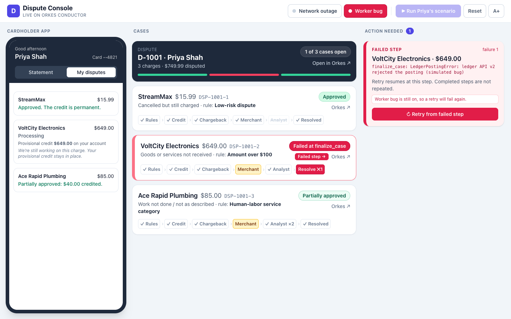

3. **Worker bug** off ("we shipped the fix"), then **Retry from failed step**. The case resumes at that step and closes.

**Say:** three layers. Short outages are absorbed by automatic retries. A long outage becomes a work item for ops,
not a dead case. A real bug fails loudly, and after the fix the case resumes exactly where it stopped: nothing before
it runs again, so Priya is credited once.

**Show in Orkes:** VoltCity's case → **Timeline**. The failed `file_chargeback` attempts with their doubling gaps, the ops
task, the retry and the merchant wait. Click a failed attempt for its error and worker log.

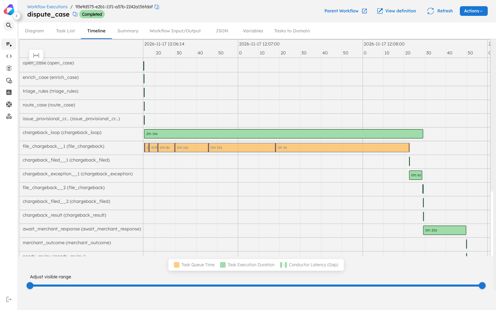

### Act 5: The parent closes last

**What happens:** with VoltCity resolved, the dispute closes: *Opened*, *Last case closed* and *Dispute closed* times
in that order, $704.99 credited of $749.99. Priya's app shows one letter for the whole dispute.

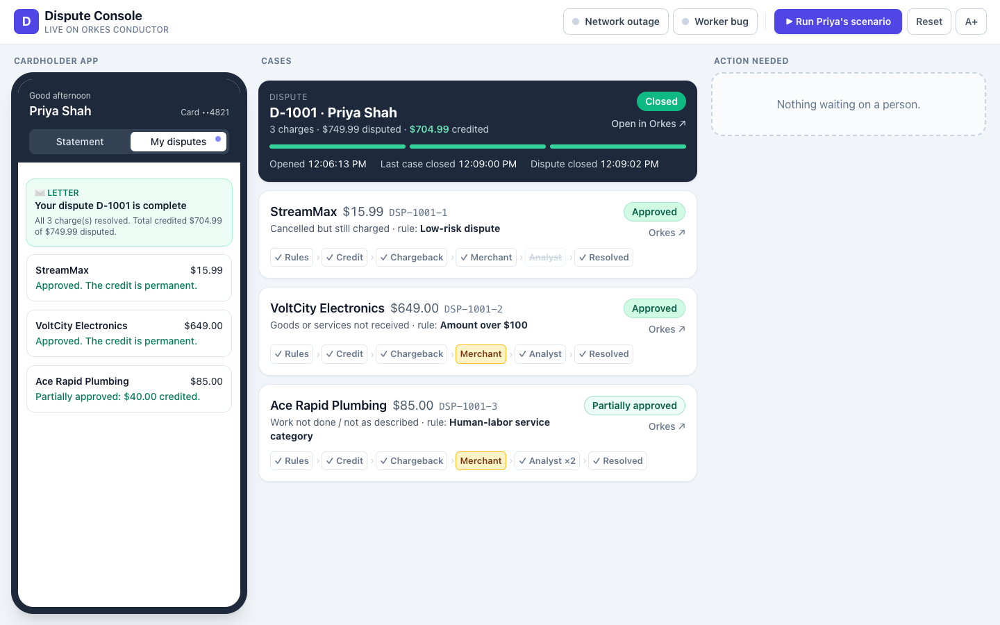

**Say:** one call, one case per charge, and the dispute closed only after its last case.

**Show in Orkes:** **Open in Orkes ↗** on the dark card: the parent is `COMPLETED`, with every case, retry and human
decision in its history. In the console, clicking VoltCity shows the same story from the case's side:

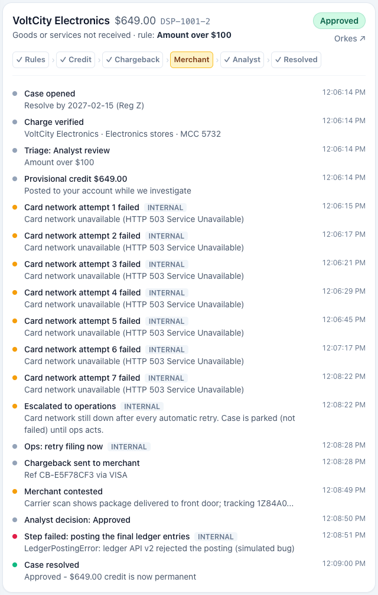

### Optional: change a rule live (2 minutes)

1. In Orkes, open **Definitions → Decision Rules → `dispute_triage_rules`**, change `>100` to `>500` in the *amount* column and **Save**.
2. In the console's cardholder app (**Statement**), dispute a **FreshCart Grocery** charge between $100 and $500.
   It's auto-approved as *Low-risk dispute*, where before it would have gone to an analyst.
3. Change it back, or restart the demo (container or `start.sh`), which restores the rules from `rules/dispute_rules.csv`.

### Customer questions

**Is there user task management, and can we tailor how tasks are presented?**
- **Definitions → User Forms** has `dispute_review_form` and `chargeback_exception_form`: a drag-and-drop layout, read-only fact fields, validation, and fields that appear only when relevant (for example, the amount only for *Partial*).
- Assignment and escalation are set per task: a group, an SLA, then the next group.
- Tasks can be worked in the Orkes **Human Tasks** inbox, or in your own UI through the API, as this console does.

**Can we search on custom attributes within a workflow?**
- In Orkes **Executions → Workflow**, search by correlation ID (`D-1001`) or free text over workflow input and output: a case ID (`DSP-1001-2`), a cardholder ID (`CH-1001`), a merchant (`VoltCity`) or a route (`HUMAN_REVIEW`). Combine with filters such as workflow type and status.
- Be clear that Orkes has no typed, indexed custom search attributes. The pattern is a business key as the correlation ID, plus the attributes in the workflow input.

**What observability is there out of the box?**
- A live, colour-coded execution diagram, with drill-down into sub-workflows.
- A timeline of every task, with retry gaps visible.
- Each task's input, output, retry history and worker logs.
- Workflow variables, search, and the **Queue Monitor** (are workers polling, and how deep is each queue?).
- Operations from the UI or the API: retry, rerun from a task, restart, pause and terminate.

---

## 6. Stop, reset, troubleshoot

- **Stop:** press Ctrl+C in the terminal running the container or `start.sh`. This stops the app and all workers.
- **Reset between runs:** click **Reset** in the console. It terminates running disputes and reseeds the bank data.
- **Full reset:** restart the container or `start.sh`. This also deletes old executions from Orkes and restores the triage rule, unless you set `KEEP_DATA=1` or pass `--keep`.

| Symptom | Fix |
|---|---|
| `✗ Missing: CONDUCTOR_...` | Create `.env` at the repository root from `.env.example` and fill in all three Orkes values. With a container, check that you passed `--env-file ../.env` from the `dispute_demo` folder. |
| `✗ Orkes rejected the request (401/403)` | The key ID or secret is wrong, or the application lacks the **Worker** or **Metadata API** role. |
| `✗ The access key can't manage decision rules` | Add the **Business Rule Manager** role to the application (**Access Control → Applications**). |
| `✗ Orkes ... is too old` | Saved decision rules need Orkes v5.6 or later. |
| `CONDUCTOR_SERVER_URL should end with /api` | Use `https://<cluster>/api`, not the UI address. |
| Registration fails on the forms or `HUMAN` tasks | Human Tasks aren't enabled on the cluster. |
| `Address already in use` / `port is already allocated` | Something else is using port 8000. Use `-p 9000:8000` with the container, or `PORT=9000 ./dispute_demo/start.sh`. |
| "Priya's three charges are already disputed" | Click **Reset** first. |
| Cases stuck at *Processing* with no progress | The workers aren't running. Check the container or `start.sh` output for errors and restart it. |
| The console is blank or unstyled | The browser can't reach the Tailwind or Alpine.js CDNs (a proxy, or you're offline). |
| `start.sh`: you want to use an existing Python env | Run `PYTHON=/path/to/python ./dispute_demo/start.sh`, or activate the env before running it. |

---

## 7. Automated end-to-end test

With the demo running (container or `start.sh`), in a second terminal:

```bash
cd dispute_demo
../.venv/bin/python scripts/smoke_test.py      # or any Python with `requests`
```

The test only calls the console's web API, so it works against the container too (add `--base http://localhost:9000` for another port).

It drives the whole story through the web API in about 8 minutes, with 27 checks: the main dispute, retries,
the question-and-answer loop, a partial approval, the parent closing last, a long outage handled by ops, and a worker bug
fixed with Retry. Click **Reset** in the console (or restart the demo) afterwards.

---

## 8. Project layout

```
dispute_demo/
├── Dockerfile                  container image: app + workers (env vars listed inside)
├── docker-entrypoint.sh        container startup: check, register, reset, run
├── start.sh                    without a container: set up Python, register, reset, run
├── run.py                      starts the web app and workers (used by both)
├── requirements.txt
├── workflows/
│   ├── dispute_intake.json     parent workflow
│   ├── dispute_case.json       child workflow (one per charge)
│   └── task_defs.json          worker task definitions: retries, backoff, timeouts
├── forms/                      Orkes user forms for the analyst and ops Human tasks
├── rules/dispute_rules.csv     starting content of the dispute_triage_rules decision rule
├── workers/dispute_workers.py  the workers: one function per workflow box
├── app/
│   ├── main.py                 web app and JSON API
│   ├── cases.py                turns an Orkes execution into a case stage, steps and timeline
│   ├── merchant_sim.py         merchant auto-replies; ends the parent's re-check timer early
│   ├── orkes.py                small Orkes REST client
│   └── static/console.html     the one-screen console
├── bank/                       SQLite "core banking": schema and synthetic data
├── docs/images/                screenshots used in this README
└── scripts/
    ├── check_setup.py          .env, connection, version and role checks
    ├── register.py             saves the decision rule; registers definitions, forms and workflows
    ├── reset_demo.py           terminates or purges executions and reseeds data
    └── smoke_test.py           end-to-end test
```

---

## 9. Design notes

- **Why the parent checks the case system after the JOIN.** The fork's children are `optional`, so one failed case
  never cancels its siblings. But a failed optional child counts as "done" for the JOIN, and retrying the child later
  doesn't reopen the parent (verified on v5.5.11). Making the children required is worse: one failure fails the parent
  and terminates every sibling. So after the JOIN, `collect_case_results` asks the case system whether every case is
  closed, and the parent sleeps on a durable 30-second `WAIT` until it is. When every case is closed, the app's
  background loop completes that `WAIT` early, so the parent closes within seconds rather than up to 30. Without the
  app, the timer still closes it.
- **Merchant deadline.** `await_merchant_response` is a `WAIT` with a 3-minute duration (30 days in real life). A merchant
  reply completes it early through the API. If it expires, the merchant didn't respond and the cardholder wins.
- **The outage hits one merchant.** The `outage_scope` setting is `all` or a merchant name. The console targets VoltCity,
  so a live run shows one case in trouble while the others carry on; the smoke test uses `all`.
- **Rules saved in Orkes.** The `BUSINESS_RULE` task uses `ruleName` (Orkes v5.6+) rather than a file URL, so there's
  nothing to host and no rule cache to wait for. `register.py` saves `rules/dispute_rules.csv` to the rule on every run.
- **Human task API.** The Python SDK (2.0.0) has no human-task client, so `app/orkes.py` calls the `/api/human/tasks`
  REST endpoints directly. The console claims each task as an external user and completes it, and Orkes validates the
  output against the form's schema.
- **Idempotency.** The workers that write money are safe to retry. Ledger entries are unique per case and entry type,
  so a retried or resumed step can't post a credit twice.
