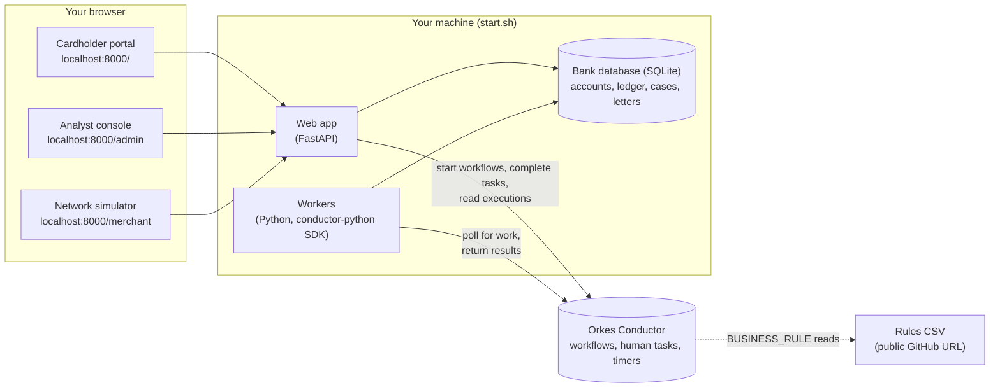

# Credit card disputes on Orkes Conductor

A working demo of a card issuer's dispute process, built on [Orkes Conductor](https://orkes.io).

> **One call, one case per charge, the parent closes last.**
> A cardholder disputes several charges at once. Each charge becomes its own case with its own ID, deadline,
> merchant investigation and lifecycle. The parent dispute watches all of them and closes only after the last one.

What you can show with it:

| Capability | Where you see it |
|---|---|
| Fan-out: one case per charge, parent closes last | Parent workflow with a dynamic fork of child workflows |
| Business rules as configuration | A decision table (CSV) read by a `BUSINESS_RULE` task |
| Human in the loop | Analyst review form, request-info loop with the cardholder, SLA escalation |
| Long waits without using resources | Merchant response deadline and cardholder answers as `WAIT` tasks |
| Durability | Automatic retries, an ops exception queue, and "retry from the failed step" |
| Search and observability | Orkes execution search, diagrams, timelines, task logs |

**Contents**
1. [How it works](#1-how-it-works)
2. [Prerequisites](#2-prerequisites)
3. [Start the demo](#3-start-the-demo)
4. [The screens](#4-the-screens)
5. [Demo walkthrough, step by step](#5-demo-walkthrough-step-by-step)
6. [Stop, reset, troubleshoot](#6-stop-reset-troubleshoot)
7. [Automated end-to-end test](#7-automated-end-to-end-test)
8. [Project layout](#8-project-layout)
9. [Design notes](#9-design-notes)

---

## 1. How it works

### The pieces

Everything except Orkes runs on your machine, started by one script.



- **Orkes** runs the process. It decides what happens next, holds every wait (merchant deadline, analyst, cardholder) and retries failures.
- **Workers** do the actual work against the "bank": open a case, post a credit, file a chargeback, send a letter. Each worker is one box in the workflow diagram.
- **The web app** is what people click. It starts workflows, completes human and wait tasks, and reads the live execution from Orkes to show where each case is. There is no status-syncing code: Orkes is the source of truth for where a case is, and the bank database is the source of truth for money.

### Parent workflow: `dispute_intake` (one per dispute)


The dispute ID (e.g. `D-1001`) is the workflow's **correlation ID**, so you can search for it in Orkes.

### Child workflow: `dispute_case` (one per charge)


### Triage rules

`rules/dispute_rules.csv` is a decision table. The `triage_rules` task reads it, and the **first matching row wins**.

| outsideWindow | amount | category | priorDisputes90d | route | reason |
|---|---|---|---|---|---|
| true | Any | Any | Any | AUTO_DENY | Outside the 60-day dispute window |
| Any | >100 | Any | Any | HUMAN_REVIEW | Amount over $100 |
| Any | Any | contractor, home, personal or professional services, repair | Any | HUMAN_REVIEW | Human-labor service category |
| Any | Any | Any | >3 | HUMAN_REVIEW | Repeat disputer |
| Any | Any | Any | Any | AUTO_APPROVE | Low-risk dispute |

### When things go wrong: a case never silently dies


### The request-info loop, as a sequence

```mermaid
sequenceDiagram
  actor Analyst
  participant Console as Analyst console
  participant Orkes
  participant Portal as Cardholder portal
  actor Cardholder
  Orkes->>Console: case waits in analyst_review (Human task)
  Analyst->>Console: Request info + question
  Console->>Orkes: claim and complete the Human task
  Orkes->>Portal: notify_cardholder writes the question, then a WAIT starts
  Cardholder->>Portal: types an answer
  Portal->>Orkes: complete the WAIT task with the answer
  Orkes->>Console: loop: a new analyst_review, now including the answer
  Analyst->>Console: Partial approve $40
  Console->>Orkes: complete the Human task, case moves to finalize_case
```



---

## 2. Prerequisites

| You need | Notes |
|---|---|
| An **Orkes Conductor** cluster | Orkes Cloud or Enterprise, with **Human Tasks** enabled. Tested on v5.5.11. Open-source Conductor doesn't have the `HUMAN` and `BUSINESS_RULE` tasks this demo uses. |
| An **application access key** | In the Orkes UI: **Access Control → Applications → Create application**. Give it the **Worker** and **Metadata API** roles (tested with those plus **Application Creator**), then **Create access key** and copy the key ID and secret. Everything the demo registers is owned by this application. |
| **Python 3.10 or newer** | Check with `python3 --version`. [uv](https://docs.astral.sh/uv/) is optional; the script uses it if present because it's faster. |
| A macOS or Linux shell | On Windows, use WSL. |
| Internet access | The pages load Tailwind and Alpine.js from public CDNs, and Orkes reads the rules CSV from GitHub. |
| Port 8000 free | Or choose another with `PORT=9000`. |

---

## 3. Start the demo

```bash
git clone https://github.com/mangatrai/conductor-demos.git
cd conductor-demos
cp .env.example .env          # then edit .env (see below)
./dispute_demo/start.sh
```

Edit `.env` (at the repository root) before running the script:

```bash
CONDUCTOR_SERVER_URL=https://<your-cluster>.orkesconductor.io/api   # must end with /api
CONDUCTOR_AUTH_KEY=<key id>
CONDUCTOR_AUTH_SECRET=<key secret>
DISPUTE_RULES_URL=https://raw.githubusercontent.com/mangatrai/conductor-demos/main/dispute_demo/rules/dispute_rules.csv
```

`start.sh` does everything, in this order:

1. Picks a Python: `$PYTHON` if set, else your active virtualenv, else it creates `.venv` at the repository root.
2. Installs `dispute_demo/requirements.txt`.
3. Checks `.env` and connects to Orkes. If something is wrong, it stops here and says what to fix.
4. Registers the task definitions, the two user forms and the two workflows in Orkes. Re-running this is safe.
5. Resets the demo: terminates and deletes earlier `dispute_*` executions and reseeds the bank data. Use `./dispute_demo/start.sh --keep` to skip this step.
6. Starts the web app and the workers, and stays in the foreground. **Ctrl+C** stops everything.

When it's ready you'll see:

```
==> Starting web app + workers (Ctrl+C to stop)
  Cardholder portal   http://localhost:8000/
  Analyst console     http://localhost:8000/admin
  Network simulator   http://localhost:8000/merchant
Dispute workers polling. Ctrl+C to stop.
```

**Before you present**, open four browser tabs: the three links above and your Orkes UI
(**Executions** page). Side by side works best, with the portal on one half and the console on the other.

---

## 4. The screens

**Cardholder portal** (`/`): the bank's customer website, "Northstar Card".
- **Signed in as** (top right) switches between the four demo cardholders.
- **Transactions**: three statements of charges. Tick charges, then click **Dispute charges**.
- **My disputes**: each dispute with its cases, a progress timeline and any question from the bank.
- **Messages**: letters the bank sent (received, question, case resolved, summary).

**Analyst console** (`/admin`): the bank's back office.
- **Review queue**: cases waiting for an analyst's decision.
- **Ops exceptions**: cases that need operations (chargeback not filed, or a failed step).
- **All cases**: every case with its live stage, filterable by stage.
- **Search**: Orkes workflow search by dispute ID, case ID, cardholder ID, merchant or route.
- Click any case to see its facts, ledger, timeline (built from the Orkes execution) and action panel.

**Network simulator** (`/merchant`): plays the card network and the merchants.
- **Network outage**: makes every chargeback call fail with HTTP 503.
- **Merchant auto-reply**: merchants answer on their own about 20 seconds after a chargeback (on by default).
- **Worker bug**: makes the final ledger step fail hard, like a bad deploy.
- **Chargebacks in flight**: a countdown to each merchant's deadline, with **Accept** and **Contest** buttons to answer by hand.

**Demo cardholders**

| Cardholder | Story | Charges worth disputing |
|---|---|---|
| **Priya Shah** (CH-1001) | Everyday spender; the main story | StreamMax $15.99, VoltCity Electronics $649.00, Ace Rapid Plumbing $85.00, SkyBridge Airlines $389.40 (past the dispute window) |
| **Marcus Johnson** (CH-1002) | Homeowner: contractors and services | CloudVault Storage $9.99, BrightSpark Electric $380.00, HomeNest Furniture $1,250.00 |
| **Elena Rossi** (CH-1003) | Traveller | Harborview Hotel $289.00 (charged twice), TuneWave Music $10.99, RoadRunner Car Rental $176.25 |
| **Jordan Lee** (CH-1004) | Four disputes in the last 90 days | Anything: every dispute goes to review as a repeat disputer |

Merchants in the simulator behave differently:
- StreamMax, CloudVault, TuneWave and Harborview **accept**.
- Ace, BrightSpark, HomeNest, SkyBridge and RoadRunner **contest**.
- VoltCity's network connection **times out twice**, and then the merchant contests.
- Some merchants stay **silent** until the deadline passes.

---

## 5. Demo walkthrough, step by step

Everything takes about 20 minutes. Parts 1 to 6 are the main story (about 10 minutes); parts 7 to 10 are optional deep dives.
Each part says what to click, what happens and what to point out.

### Part 1: File one dispute with three charges

1. Open the **portal**. You're signed in as **Priya Shah**.
2. On **Transactions**, tick three charges:
   - **StreamMax** $15.99 (StreamMax Premium monthly)
   - **VoltCity Electronics** $649.00 (65in 4K TV)
   - **Ace Rapid Plumbing** $85.00 (service call)
3. Click **Dispute charges** in the bar at the bottom.
4. Pick a reason for each:
   - StreamMax: **Cancelled but still charged**
   - VoltCity: **Goods or services not received**
   - Ace: **Work not done / not as described**
5. Click **Submit dispute**.

**What happens:** the portal switches to **My disputes**. Dispute `D-1001` has three cases, `DSP-1001-1` to `DSP-1001-3`.
A "We received your dispute" letter appears under **Messages**.

**Show in Orkes:** **Executions** → search `D-1001` → open the `dispute_intake` execution. The diagram shows the
dynamic fork with three `dispute_case` sub-workflows running side by side. Click one to drill into that case.

> Point out: one call from the customer, three independent cases, each with its own ID, deadline and lifecycle.

### Part 2: Rules route each case

Open the **console** → **All cases**. Each case shows its triage result:
- StreamMax: *Low-risk dispute* (auto-approve path)
- VoltCity: *Amount over $100* (analyst review)
- Ace: *Human-labor service category* (analyst review)

**Show in Orkes:** in a `dispute_case` execution, click the `triage_rules` task. Its **Input** has the facts
(amount, category, window, history), and its **Output** has `route` and `reason`. Then show `rules/dispute_rules.csv`:
the routing is a table, not code.

### Part 3: The simple case finishes first

Wait about 30 seconds. In the **portal** (My disputes), StreamMax moves through
provisional credit → chargeback filed → merchant accepted → **Approved**, and a "Case resolved" letter arrives.
Its two siblings are still open, so the dispute stays **Open**.

> Point out: the cases are independent. The cheap, clear-cut one is done in seconds while the others wait for people.

### Part 4: Retries you never notice

VoltCity's network connection timed out twice before the chargeback went through.

1. In the **console**, go to **All cases** and click **VoltCity**. The timeline shows orange *"Card network attempt 1 failed"* and *"attempt 2 failed"*, then *"Chargeback sent to merchant"*.
2. In the **portal**, the same case shows none of this; the cardholder only sees progress.

**Show in Orkes:** in the VoltCity `dispute_case`, open the `file_chargeback` task. It shows each attempt with its error, the backoff
between attempts, and the worker's **Logs** tab.

### Part 5: Human in the loop

After about 20 seconds VoltCity's merchant contests. VoltCity and Ace are now in the console's **Review queue**,
each with the reason it's there and the merchant's response.

1. Click **Ace Rapid Plumbing**. Choose **Request info**, type a question (e.g. *"Did the plumber come back to finish the job?"*) and click **Submit decision**.
2. In the **portal**, open **My disputes**. The Ace case shows the bank's question in an amber box with an answer field. Type an answer and click **Send answer**.
3. Back in the **console**, Ace returns to the queue tagged **Cardholder replied**, with the conversation shown.
4. Choose **Partial**, enter **40**, add a note and click **Submit decision**.
5. Click **VoltCity Electronics**, choose **Approve in full** and click **Submit decision**.

**Show in Orkes:**
- **Human tasks** (the inbox): the same tasks are there. The console is the bank's own UI working the same Orkes tasks through the API.
- **Definitions → User forms → `dispute_review_form`**: the form the analyst fills in, built in a drag-and-drop editor with validation.
- In the Ace execution, the `review_loop` ran twice, and the `await_cardholder_info` `WAIT` held the case while the cardholder answered.

> Point out: the task is assigned to the `dispute-analysts` group with a 4-hour SLA, then escalates to `dispute-supervisors`.

### Part 6: The parent closes last

Once VoltCity and Ace resolve:
- **Portal → Messages**: one summary letter, *"All 3 charge(s) resolved. Total credited $704.99 of $749.99 disputed."*
- **Portal → Transactions**: the balance includes the credits.
- **Orkes**: the `dispute_intake` execution is **COMPLETED**, after its last case.

> That's the core story. Parts 7 to 10 go deeper into durability, configuration and the customer's questions.

### Part 7: A network outage (durability layers 1 and 2)

1. In the **simulator**, turn **Network outage** on.
2. In the **portal**, use **Signed in as** to switch to **Elena Rossi**. Dispute **TuneWave Music** $10.99 (*Cancelled but still charged*).
3. In the **simulator**, the case appears under chargebacks in flight with *"Card network retrying"*.
   In **Orkes**, `file_chargeback` fails and is retried with growing gaps (2, 4, 8, 16, 32 and 64 seconds).
4. Choose one ending:
   - **Short outage:** turn **Network outage** off within about a minute. The next retry succeeds and the case carries on by itself.
   - **Long outage:** leave it on for about 2 minutes. The retries run out, but the case **doesn't fail**.
     It appears in **console → Ops exceptions** as *"Ops: chargeback not filed"*, with the error.
     In Orkes the case is RUNNING, waiting on the `chargeback_exception` Human task, and the parent is still RUNNING.
     The portal just shows *Processing* with *"Your provisional credit stays in place"*.
     Now turn the outage **off**, open the case in **Ops exceptions**, optionally add a note, and click **Retry filing now**.
     The workflow loops back and files the chargeback, the merchant accepts, and the case and its parent complete.

> Point out: a long outage becomes a work item with an owner and an SLA (`dispute-ops` for 30 minutes, then `dispute-ops-leads`),
> not a failed case. The other option, **Proceed without chargeback**, has the bank absorb the loss while the case continues.

### Part 8: A bug in the code (durability layer 3)

1. In the **simulator**, turn **Worker bug** on (and make sure Network outage is off).
2. In the **portal**, switch to **Marcus Johnson** and dispute **CloudVault Storage** $9.99 (*Cancelled but still charged*).
3. After about 25 seconds, when the merchant accepts, **console → Ops exceptions** shows the case in red:
   **Failed at finalize_case**, *"LedgerPostingError: ledger API v2 rejected the posting"*.
   In **Orkes**, the case workflow is **FAILED** with a non-retryable error, so there are no pointless retries.
   The parent is still **RUNNING**: it checks every 30 seconds and won't close while a case is open.
4. In the **simulator**, turn **Worker bug** off ("we deployed the fix").
5. In the **console**, open the case and click **Retry from failed step** (or press **Retry** on the execution in Orkes).

**What happens:** the case resumes at `finalize_case` and resolves. Nothing before it runs again: the ledger shows
**one** provisional credit, and the merchant isn't asked again. Within 30 seconds the parent completes and Marcus gets his summary letter.

### Part 9: Change a rule without a deploy

The rules are a CSV at a public URL, so to edit them you need your own copy:

1. Fork this repository on GitHub. In `.env`, set `DISPUTE_RULES_URL` to your fork's raw URL,
   `https://raw.githubusercontent.com/<you>/conductor-demos/main/dispute_demo/rules/dispute_rules.csv`.
   Run `./dispute_demo/start.sh` again so the workflow uses it.
2. Show the "before": as **Elena Rossi**, dispute **Harborview Hotel** $289.00. It goes to **analyst review** (*Amount over $100*).
3. In your fork on GitHub, edit `dispute_demo/rules/dispute_rules.csv`: change `>100` to `>500` and commit.
4. Wait a few minutes. Orkes caches the rules for 1 minute, and GitHub's raw file server can serve the old copy for up to 5.
5. Dispute Elena's **other** Harborview Hotel $289.00 charge. It now **auto-approves** (*Low-risk dispute*).

> Tip: push the rule change at the start of the demo and come back to it at the end.

### Part 10: The three customer questions

**Is there user task management, and can we tailor how tasks are presented?**
- **Definitions → User forms** has `dispute_review_form` and `chargeback_exception_form`, with a drag-and-drop layout, read-only fact fields, validation, and fields that appear only when relevant (e.g. the amount only for *Partial*).
- Assignment and escalation are set per task: a group, an SLA, then the next group.
- Tasks can be worked in the Orkes **Human tasks** inbox, or in your own UI through the API, as this console does.

**Can we search on custom attributes within a workflow?**
- Use **Console → Search** or Orkes **Executions** search. Try `D-1001` (a correlation ID), `DSP-1001-2`, `CH-1001`, `VoltCity` or `HUMAN_REVIEW`.
- This is free-text search over workflow input and output, plus the correlation ID and filters such as workflow type and status.
- Be clear that Orkes has no typed, indexed custom search attributes. The pattern is a business key as the correlation ID, plus the attributes in the workflow input.

**What observability is there out of the box?**
- A live, colour-coded execution diagram, with drill-down into sub-workflows.
- A timeline (Gantt view) of every task, with the backoff gaps visible.
- Each task's input, output, retry history and worker logs.
- Workflow variables, search, and the **Task queues** page (are workers polling, and how deep is the queue?).
- Operations from the UI or the API: retry, rerun from a task, restart, pause and terminate.

---

## 6. Stop, reset, troubleshoot

- **Stop:** press Ctrl+C in the terminal running `start.sh`. This stops the app and all workers.
- **Reset for the next audience:** run `./dispute_demo/start.sh` again. It resets the data and executions unless you pass `--keep`.
- **Reset without restarting:** in another terminal, run `cd dispute_demo && ../.venv/bin/python scripts/reset_demo.py --purge` (or use your own Python env).

| Symptom | Fix |
|---|---|
| `✗ Missing in .../.env` | Create `.env` at the repository root from `.env.example` and fill in all three Orkes values. |
| `✗ Orkes rejected the request (401/403)` | The key ID or secret is wrong, or the application lacks the **Worker** or **Metadata API** role. |
| `CONDUCTOR_SERVER_URL should end with /api` | Use `https://<cluster>/api`, not the UI address. |
| Registration fails on the forms or `HUMAN` tasks | Human Tasks aren't enabled on the cluster. |
| `Address already in use` | Something else is using port 8000. Run `PORT=9000 ./dispute_demo/start.sh`. |
| Cases stuck at *Processing* with no progress | The workers aren't running. Check the `start.sh` terminal for errors and restart it. |
| A case sits at *Awaiting merchant* | That merchant is silent or manual. Use **Accept** or **Contest** in the simulator, or wait for the 3-minute deadline. |
| Pages are blank or unstyled | The browser can't reach the Tailwind or Alpine.js CDNs (a proxy, or you're offline). |
| A rule change has no effect | Wait for both caches (up to about 6 minutes), check that `DISPUTE_RULES_URL` points at the file you edited, and rerun `start.sh` if you changed it. |
| You want to use an existing Python env | Run `PYTHON=/path/to/python ./dispute_demo/start.sh`, or activate the env before running it. |

---

## 7. Automated end-to-end test

With the demo running, in a second terminal:

```bash
cd dispute_demo
../.venv/bin/python scripts/smoke_test.py      # or your own Python env
```

It drives the whole story through the web API in about 8 minutes, with 26 checks: the main dispute, retries,
the request-info loop, a partial approval, the parent closing last, a long outage handled by ops, and a worker bug fixed
with Retry. Run `start.sh` again afterwards to reset.

---

## 8. Project layout

```
dispute_demo/
├── start.sh                    one command: set up, register, reset, run
├── run.py                      starts the web app and workers (used by start.sh)
├── requirements.txt
├── workflows/
│   ├── dispute_intake.json     parent workflow
│   ├── dispute_case.json       child workflow (one per charge)
│   └── task_defs.json          worker task definitions: retries, backoff, timeouts
├── forms/                      Orkes user forms for the analyst and ops Human tasks
├── rules/dispute_rules.csv     triage decision table (BUSINESS_RULE)
├── workers/dispute_workers.py  the workers: one function per workflow box
├── app/
│   ├── main.py                 web app and JSON API
│   ├── cases.py                turns an Orkes execution into a case stage and timeline
│   ├── merchant_sim.py         merchant auto-replies
│   ├── orkes.py                small Orkes REST client
│   └── static/                 portal, console and simulator pages
├── bank/                       SQLite "core banking": schema and synthetic data
└── scripts/
    ├── check_setup.py          .env and connection check
    ├── register.py             registers definitions, forms and workflows in Orkes
    ├── reset_demo.py           terminates or purges executions and reseeds data
    └── smoke_test.py           end-to-end test
```

---

## 9. Design notes

- **Why the parent checks the case system after the JOIN.** The fork's children are `optional`, so one failed case
  never cancels its siblings. But a failed optional child counts as "done" for the JOIN, and retrying the child later
  doesn't reopen the parent (verified on v5.5.11). Making the children required is worse: one failure fails the parent
  and terminates every sibling. So after the JOIN, `collect_case_results` asks the case system whether every case is
  closed, and the parent sleeps on a durable 30-second `WAIT` until it is.
- **Merchant deadline.** `await_merchant_response` is a `WAIT` with a 3-minute duration (30 days in real life). A merchant
  reply completes it early through the API. If it expires, the merchant didn't respond and the cardholder wins.
- **Where the rules live.** On v5.5, the `BUSINESS_RULE` task reads the table from a public URL; saved rules managed inside
  Orkes need v5.6 or later. Without `DISPUTE_RULES_URL`, `register.py` falls back to an `INLINE` task with the same
  rules and output, which you can edit in the workflow editor.
- **Human task API.** The Python SDK (2.0.0) has no human-task client, so `app/orkes.py` calls the `/api/human/tasks`
  REST endpoints directly. The console claims each task as an external user and completes it, and Orkes validates the
  output against the form's schema.
- **Idempotency.** The workers that write money are safe to retry. Ledger entries are unique per case and entry type,
  so a retried or resumed step can't post a credit twice.
